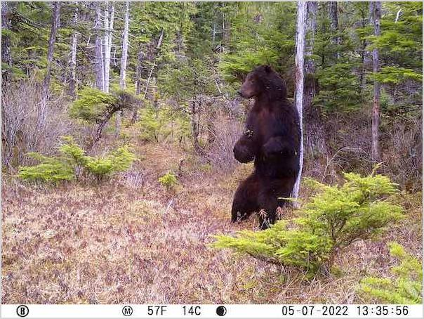

`py-image-border`
===

`py-image-border` is a simple project that lets you easily add borders to screenshots:

```
$ add-border my_screenshot.png
```

Installation sets up an `add-border` shortcut, so you don't need to use any `python` commands to use the project. If you want, you can also use the following syntax:

```
$ python -m py_image_border.add_border my_screenshot.png
```

With uv, you can use `py-image-border` without installing anything manually:

```
$ uvx --from py-image-border add-border my_screenshot.png
```

Installation
---
Install the package with `pip`:

```
$ python -m pip install py-image-border
```

The only dependency is [Pillow](https://pillow.readthedocs.io/en/stable/index.html).

Usage
---

You can adjust the size of the border, add some padding between the image and border, and set a custom color for the border:

```
# 15-pixel border:
$ add-border my_screenshot.png 15

# 10-pixel padding:
$ add-border my_screenshot.png --padding 10

# black border:
$ add-border my_screenshot.png --border-color black
```

To see the full usage documentation, use `--help`:

```
usage: add-border [-h] [--padding PADDING] [--border-color BORDER_COLOR] [--make-transparent] path [border_width]

Add a border to any image.

positional arguments:
  path                  Path to the original image.
  border_width          Border width (default: 2).

options:
  -h, --help            show this help message and exit
  --padding PADDING     Padding (default: 0).
  --border-color BORDER_COLOR
                        Border color (default: lightgray).
  --make-transparent    [Experimental] Make the background transparent (default: False).
```

Development
---

To set up a development environment, clone this repository. Then make a separate environment for using the project.

Set up a development environment, and run the tests:

```sh
$ git clone https://github.com/ehmatthes/py-image-border.git
$ cd py-image-border
$ python3 -m venv .venv
$ source .venv/bin/activate
(.venv)$ pip install --upgrade pip
(.venv)$ pip install -r requirements.txt
(.venv)$ pytest
```

Install the project to a different environment, and run help:

```sh
$ mkdir use_pyimageborder
$ cd use_pyimageborder
use_pyimageborder$ python3 -m venv .venv
use_pyimageborder$ source .venv/bin/activate
use_pyimageborder(.venv)$ pip install --upgrade pip
use_pyimageborder(.venv)$ pip install -e /local/path/to/py-image-border
use_pyimageborder(.venv)$ add-border --help
```

For development work, make any changes you want in the `py-image-border/` directory. Run the project against a test image in the `use_pyimageborder/` directory. Run the test suite as usual in the `py-image-border/` directory.

Notes
---

This project was motivated by the lack of an easy, consistent way to add borders to screenshots on macOS.

The test image is a bear I caught with a game camera, scratching its back against a tree:



I had left the game camera out much longer than expected, and had about 100k images to go through. I wrote a Python script to flag any image with an area of dark pixels. This was one of about 12 images flagged. :)